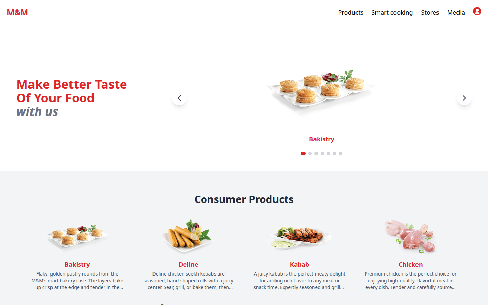
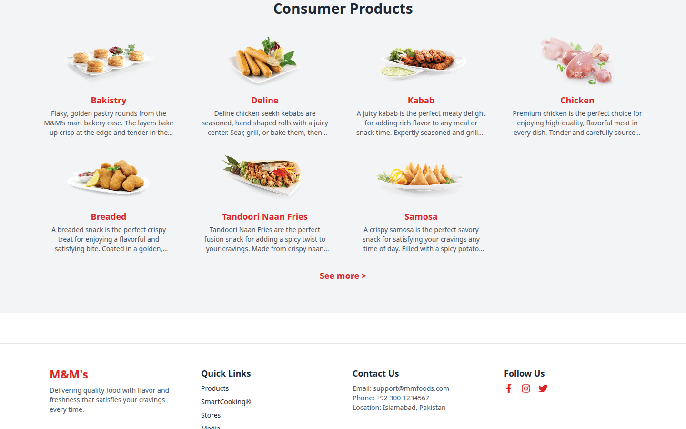
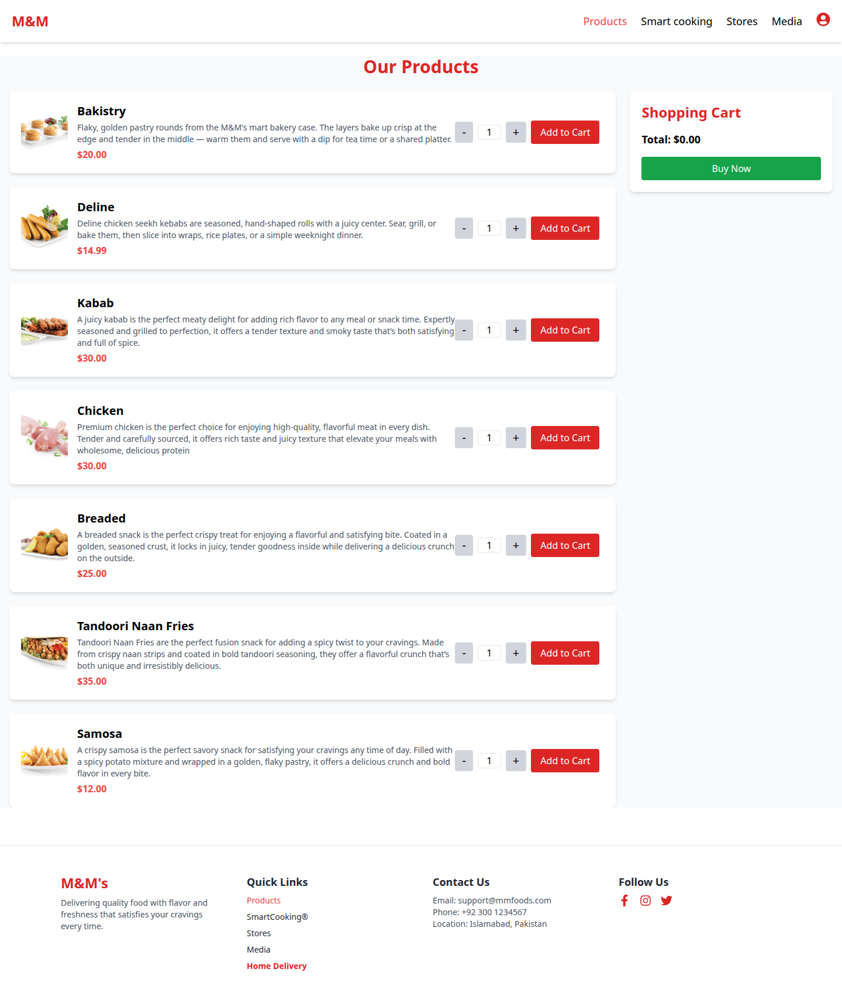
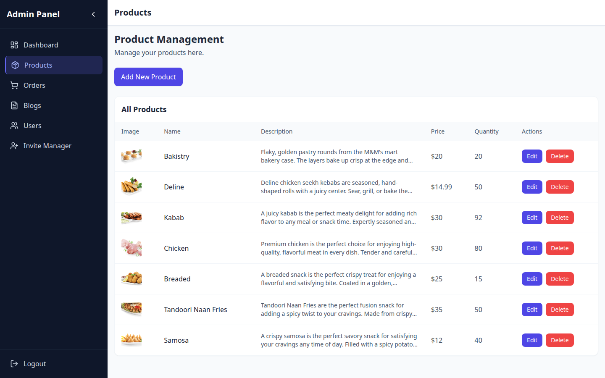

# M&M's Mart

Customer storefront and admin console for the M&M's mart demo. Shoppers browse the catalog, build a cart, and place an order. Admins manage products, orders, blogs, users, and manager invites.

**Live site:** https://mart-frontend.netlify.app/

## Features

- Home page with a product slider and the consumer catalog
- Product list with quantity controls, a shopping cart, and checkout for signed-in customers
- SmartCooking blog, plus Stores and Media pages
- Account registration, login, profile updates, and order history
- Admin dashboard, product management, orders, blogs, users, and an invite manager
- Netlify rewrite so routes such as `/products` and `/admin` keep working after a refresh
- Catalog descriptions on the storefront and in admin. Bakistry and Deline still return Lorem Ipsum from the API; this app shows store-ready copy for those items, and strips drafting notes from the other descriptions before display

## Stack

React 18, React Router 6, Vite 6, Tailwind CSS, Axios, Recharts, and Lucide. The live app is a static site on Netlify. Data comes from the companion API at `https://mart-backend-1-ci1l.onrender.com`, configured with `VITE_API_URL`.

## Architecture

A Vite React single-page app loads the catalog, orders, blogs, and accounts from the Mart REST API, and Netlify rewrites every unmatched path to `index.html` so client-side routes survive a refresh.

## Screenshots

### Storefront



### Catalog



### Products and cart



### Admin



## Demo accounts

This frontend repo does not include seed users or example passwords. Demo accounts are documented in the companion backend repo: https://github.com/hassan2314/mart-Backend

## Local development

```bash
npm install
cp .env.example .env
```

Set `VITE_API_URL` in `.env` to the Mart API, for example `https://mart-backend-1-ci1l.onrender.com/api/v1`, then start the app:

```bash
npm run dev
```

`npm run build` writes the production bundle to `dist`, including `public/_redirects` (`/*    /index.html   200`). `netlify.toml` repeats that rewrite.

## Routes

| Path | Access |
| --- | --- |
| `/` | Everyone |
| `/products` | Everyone; placing an order requires a signed-in customer |
| `/smart-cooking`, `/blogs/:id` | Everyone |
| `/stores`, `/media` | Everyone |
| `/orders`, `/update-profile` | Signed-in users |
| `/admin` | Administrators |
